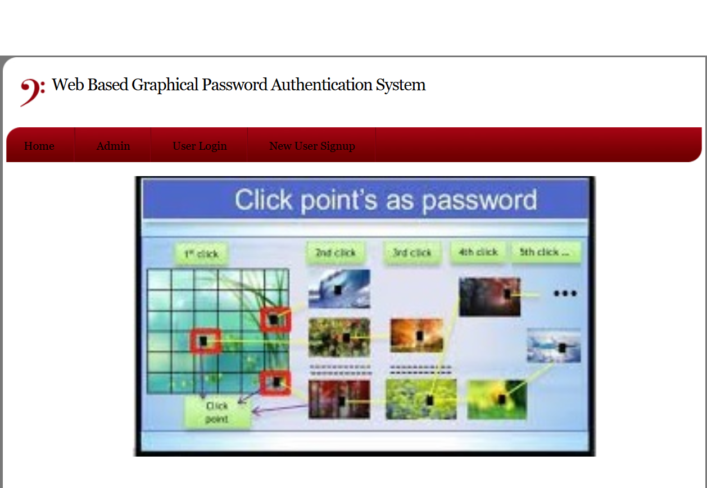
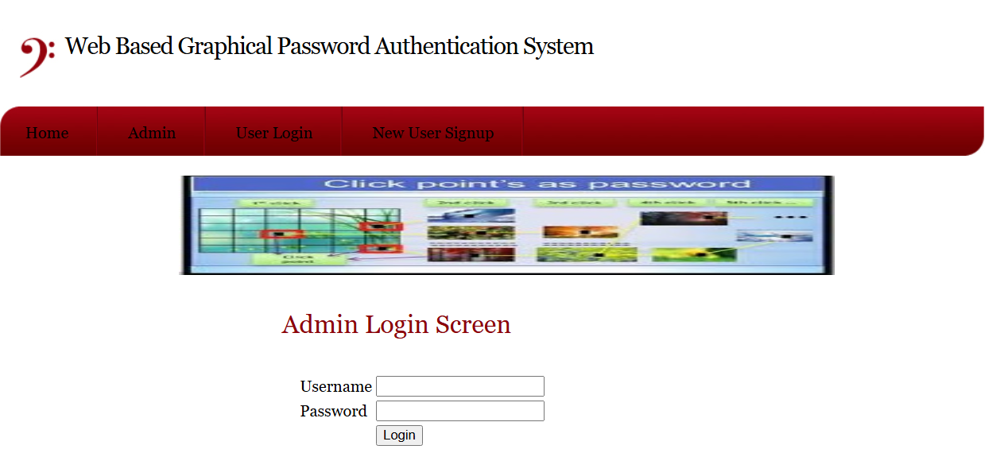
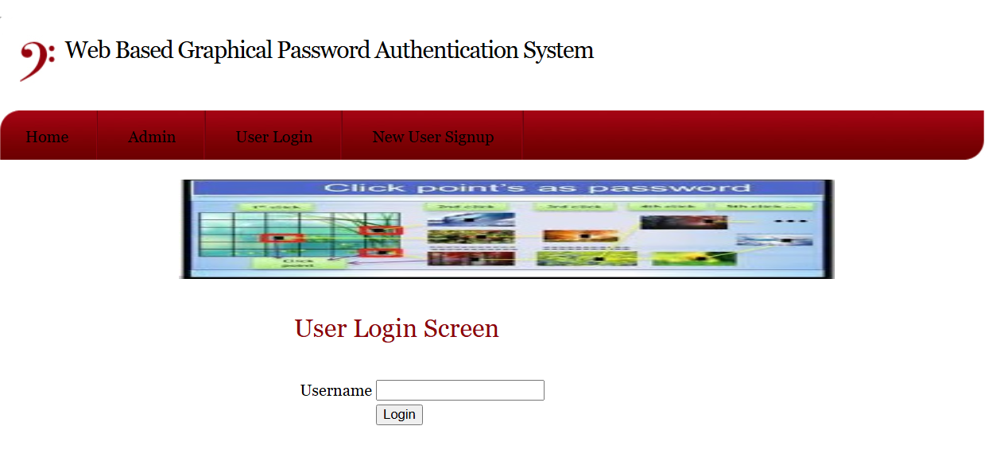

# GraphLock – Enhanced Web Security Through Graphical Password

## 📌 Project Overview

GraphLock is a web-based authentication system developed using Python and Django. It enhances traditional login security through graphical password authentication, allowing users to authenticate using image-based password selection instead of relying only on conventional text passwords.

The system provides separate user and administrator functionalities for secure authentication and management.

## 🎯 Objectives

- Provide an alternative to traditional text-based password authentication.
- Implement graphical password creation and verification.
- Develop a user-friendly authentication interface.
- Provide administrative access and management functionality.

## 🛠️ Technologies Used

| Category | Technologies |
|---|---|
| Programming Language | Python |
| Backend Framework | Django |
| Frontend | HTML, CSS, JavaScript, Bootstrap |
| Database | MySQL |
| Database Connectivity | PyMySQL |

## ✨ Key Features

### 1. User Registration
- Allows new users to register.
- Stores user registration information.

### 2. User Login
- Provides a login interface for registered users.
- Supports the application's authentication process.

### 3. Graphical Password Management
- Allows users to manage their graphical passwords.
- Provides image-based password authentication.

### 4. Graphical Password Verification
- Verifies the graphical password selected by the user.
- Accepts correct graphical passwords and rejects incorrect ones.

### 5. Admin Module
- Provides a separate administrator login.
- Supports administrative management functionality.

## 📸 Application Screenshots


### 1. Home Page



### 2. Admin Page

### 2. Login Page



### 4.User Page


## 📂 Project Structure

```text
GraphLock/
│
├── ABSTRACT/
├── DATABASE/
├── DOCUMENTATION/
├── screenshots/
│   ├── 01-homepage.png
│   ├── 02-userpage.png
│   ├── 03-loginpage.png
│   └── 04-adminpage.png
│
├── SOURCE CODE/
│   ├── manage.py
│   └── Django application files
│
└── README.md
```

## ⚙️ How to Run the Project

1. Clone the repository:

```bash
git clone https://github.com/YelleniDeepika/GraphLock.git
```

2. Open the project folder:

```bash
cd GraphLock
```

3. Navigate to the source code directory:

```bash
cd "SOURCE CODE"
```

4. Activate your Python virtual environment.

5. Install the required project dependencies.

6. Configure the MySQL database according to the project settings.

7. Run database migrations:

```bash
python manage.py migrate
```

8. Start the Django development server:

```bash
python manage.py runserver
```

9. Open the application in your browser:

```text
http://127.0.0.1:8000/
```

## 👩‍💻 Developer

**Yelleni Deepika**

B.Sc. Computer Science | 2026

**GitHub:** https://github.com/YelleniDeepika/GraphLock
## Developer
Yelleni Deepika
